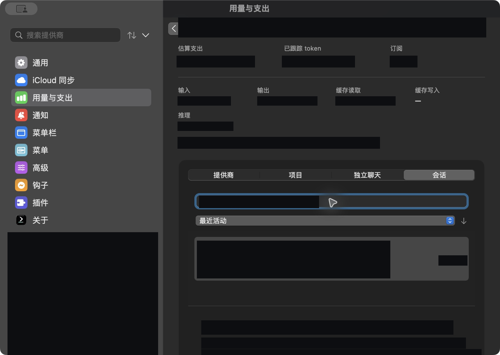
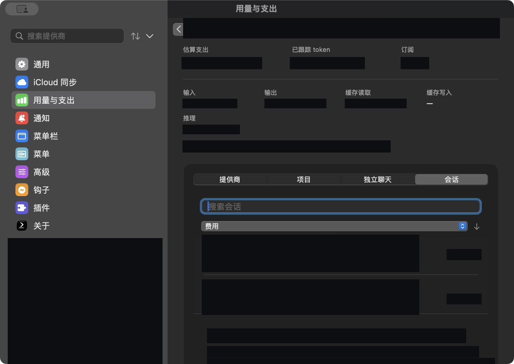
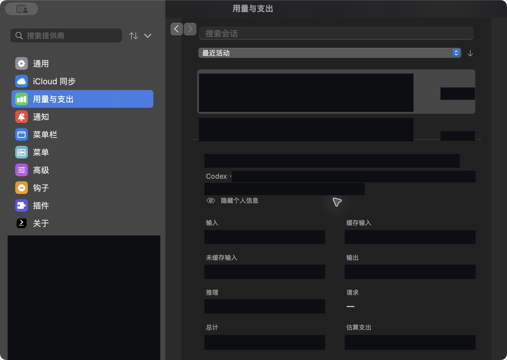

# Session inspector UI verification

## Selected-session loading

Ordinary cost refreshes retain the existing session summaries, without creating or
sorting request-detail arrays. Search, ordering, and session accounting use those
summaries. The native adapter captures the cache database and session-file identity;
the inspector does not discover accounts or scan the history directory.

Selecting a session opens that database read-only and reads only that file's rows
in one SQLite snapshot. The reader rejects changed session identities, activity
timestamps, or store schemas. Before decoding, it checks limits of 5,000 requests,
8 MiB of request payload, 1 MiB of file metadata, and 5,000 day/model aggregates
with at most 1 MiB of model names. A limit error leaves the session summary visible
and labels request details unavailable, without presenting a truncated total.

Canonical report reconciliation and pricing also build the selected session's
turns and request amounts. Persisted Priority evidence is read inside the same
transaction, with a separate 1 MiB limit on its serialized metadata envelope;
only the selected requests' turn keys are decoded into pricing records. The view
owns one bounded result, cancels previous
selection work, and drops details on leaving the inspector. Its selection key
includes the captured source, activity, price, reporting window, and time zone.
There is no request-detail history cache. Native tool inspection retains its
existing independent bounds and an all-operations entry alongside individual
turn lists, including operations without a retained billed request.

The inspector uses the source snapshot's full reporting period for both session
summaries and request details. Selecting a dashboard chart day does not narrow
these full-period accounting totals. Performance samples in the inspector also
retain that period; chart-specific performance summaries can remain day scoped.
Date labels format the last included instant before the exclusive upper bound.
An all-history source uses the localized "All" label instead of formatting its
internal unbounded-start sentinel as a year-1 date; the accounting range is unchanged.

Synthetic SQLite tests cover summary-only refreshes, selected-file isolation,
request/payload/metadata/aggregate limits, stale sources, cancellation, reporting
windows, and token/cost reconciliation. These source-level checks do not update
the installed trial application or establish the menu proof below.

## Accounting review regressions

Synthetic cases reproduced all four reviewed defects before the fix. These are
automated production-model/reader checks, not installed-app behavior evidence.

| Case | Before | After |
| --- | --- | --- |
| Two-day session, selecting either chart day | Full-period 300-token summary paired with a one-day request range | Summary, requests, performance, and tools retain the source's same two-day period |
| Reporting period October 20–21 in Asia/Shanghai | Label ended October 22; unselected tool range included an extra day | Label ends October 21; following midnight is excluded |
| Persisted Priority turn with older standard row metadata | Selected requests summed to $0.00044, while the canonical summary was $0.00066 | Selected requests sum to the same $0.00066, preserving Priority evidence |
| Billed turn A and tool-only turn B | Attributed billing suppressed the session-wide tools entry | All-operations entry exposes A and B; turn-specific entry remains scoped to A |
| All-history source viewed inside a 30-day dashboard | Internal unbounded-start sentinel appeared as a year-1 date | Label displays "All" while retaining the full source range |

The bounded reader also rejects an oversized pricing metadata envelope before
copying or decoding it. The former navigation test that only round-tripped a
request DTO was removed; reporting-scope assertions exercise the actual
dashboard-to-inspector context factory instead.

## Fresh installed application

The arm64 `0.80.0-session-trial4 (173)` application was built from trial commit
`73ef94c`, which contains feature commit `4be3874` plus the Fork-only trial
workflow. The [full release build](https://github.com/PumpkinsLemon/CodexBar/actions/runs/39907787595)
passed with Xcode 26.6 and Swift 6.3.3, including app, CLI, widget, deep strict
code-signature verification, and the packaging resource/startup smoke checks.
The downloaded artifact's commit and checksums were verified before installation.
The actual application's About pane confirmed that version and build number.

Native controls in that freshly installed Settings window established:

| Installed-app check | Observed result |
| --- | --- |
| Open Usage & Spend, then Sessions | Local session summaries and their accounting detail rendered. |
| View a session while the local index was updating | The unavailable-detail state preserved the summary; after the refresh completed and Sessions was reopened, native turns loaded. |
| Expand a native turn | Request count and input/cache/output/reasoning amounts rendered with the turn's estimated cost. |
| Expand that turn's Model requests disclosure | Individual requests rendered with their model, estimated cost, input/cache/output, timestamp, and reasoning subset. |

These are actual installed-window observations, not synthetic component renders.
Private session identities, prompts, timestamps, paths, and amounts are omitted
from this report; no new screenshots have been published. The year-1 all-history
label was discovered in this application and corrected in the subsequent source
change, with a regression through the production context factory. Trial4 does
not contain that later label correction.

Fast selection switching, forced limit/cancellation behavior, full request-to-summary
reconciliation, and the installed menu path still require runtime proof; the
focused tests cover their reader/model contracts. The GUI attempt was interrupted
by the Mac locking. Do not treat opening a disclosure as proof of those other paths.

## Installed trial baseline

Verified the installed arm64 `0.79.0-session-trial3` application on macOS 15.7.9.
Build source `93e9aec` contains feature source `590a2b1`; the release build used
Xcode 26.6 and Swift 6.3.3. See the
[successful build](https://github.com/PumpkinsLemon/CodexBar/actions/runs/39583612615).

The checks below used the actual Settings window and local session records,
with native app controls. These screenshots are distinct from the earlier
synthetic component renders. The user reviewed and approved the screenshots
with opaque masks covering session names, IDs, search text, account/source
configuration, timestamps, and usage/cost values. No replacement values were
inserted.

| Installed-app check | Result |
| --- | --- |
| Search by saved session title | Matching session retained; unrelated visible row removed. |
| Search by partial session ID | The same matching session retained. |
| Sort by cost, descending and ascending | Direction and visible row ordering updated. |
| Sort by tokens, ascending and descending | Direction and visible row ordering updated. |
| Select another session | Selection and accounting detail changed together. |
| Enable Hide personal info, then return to Sessions | Titles and full IDs hidden in session inspection. |
| Restore original preferences | Hide personal info restored to off; temporary menu shortcut cleared. |

Privacy was changed through the Advanced tab and then checked on returning to
Sessions in the same Settings window. This does not establish behavior while
the inspector remains visibly mounted. The sorting checks inspect visible
rows; the focused model tests cover ordering independently.

## Redacted installed-app screenshots

### Title search

### Cost sorting

### Privacy setting applied to inspection

## Remaining proof

Cost-menu session-row and search-icon activation have **not** been verified
through the installed menu. Computer Use permission was granted, but the tool
could not reach the status item; its temporary shortcut did not open the menu.
The shortcut was removed after the attempt.

Native event-handler tests use controlled event-tracker input. They do not prove
OS event delivery, full-row clicks, drag-out cancellation, or menu dismissal in
the installed application. Keep these paths pending; the remaining behavior
proof and maintainer feature approval are still required before merging.
